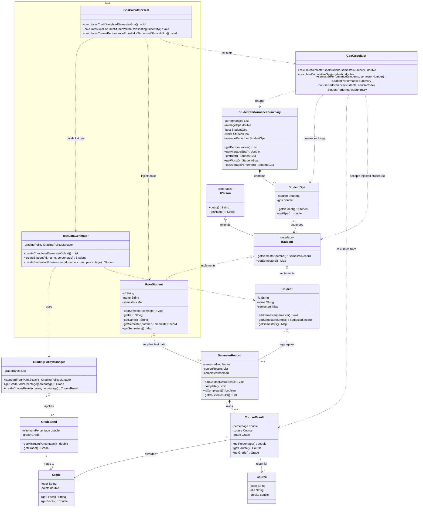

# GPA System UML Class Diagram

The diagram shows production types in `org.example.tdd.gpasystem` and test
support types in the test source set. Solid diamonds indicate composition,
open diamonds aggregation, solid arrows association, dashed arrows dependency,
and hollow triangles interface inheritance/realization.

## Behavior and constraints

- `IStudent` is the injected boundary for `GpaCalculator`. The calculator reads
  semesters and identity details through the interface; it does not require the
  concrete `Student` constructor or validate student IDs.
- A semester is numbered 1 through 8. It can be built with fewer courses while
  in progress, but `complete()` requires four or five courses and prevents
  further additions.
- `GradingPolicyManager` maps percentages to a `Grade`; `CourseResult` retains
  that grade with the course and earned percentage.
- Semester and cumulative GPA are weighted by course credits. Cumulative GPA
  and comparisons only use completed semesters.
- Course performance combines a student's completed attempts at the requested
  course. A performance summary gives the ordered student results, best, worst,
  arithmetic average GPA, and the student closest to that average.
- `FakeStudent` is deliberately permissive for unit tests (for example, it may
  return a null or blank ID). This isolates calculator behavior from production
  entity validation.
